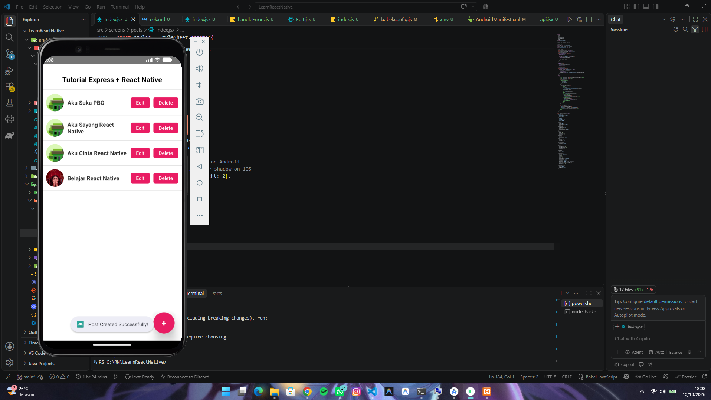
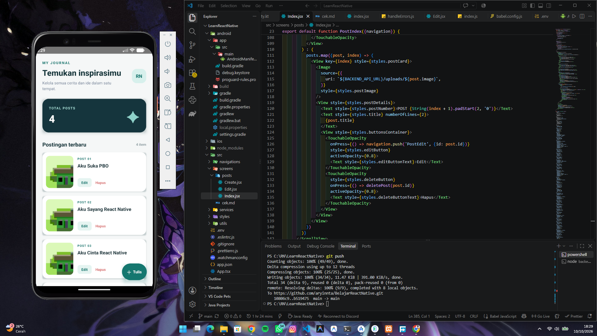

# Tugas UTS Individu - IK300 Mobile Programming

**Aplikasi Fullstack JavaScript (React Native + Express.js)**

Dokumentasi ini dibuat untuk memenuhi kriteria penilaian **Tugas UTS Individu - IK300 Mobile Programming KOM - 5A**. Project ini mengimplementasikan konsep Fullstack JavaScript Developer dengan mengintegrasikan aplikasi mobile React Native dan API Backend Express.js.

## 📌 Fitur Utama Aplikasi

1. **Get Posts Data (Fetch Data)**: Menampilkan seluruh daftar postingan yang diambil secara *real-time* dari Backend Express.js.
2. **Create Post**: Menambahkan postingan baru beserta upload gambar (menggunakan `react-native-image-picker`), *Title*, dan *Content*.
3. **Edit Post**: Mengubah data postingan yang sudah tersimpan.
4. **Delete Post**: Menghapus data postingan dari backend.

## 🛠️ Teknologi & Stack Digunakan

### Frontend (Mobile App)
* **Framework**: React Native (`v0.77.0`)
* **Language**: JavaScript / JSX
* **Environment Management**: `react-native-dotenv`
* **Media**: `react-native-image-picker`
* **Tools**: Android Studio (Emulator Pixel 4 / Android API 34), NDK `26.1.10909125`

### Backend (RESTful API)
* **Framework**: Express.js
* **Runtime**: Node.js
* **Database/Storage**: Integrated DB via Express API

## 📂 Struktur Direktori Project

```
├── LearnReactNative/            # Folder Frontend React Native
│   ├── android/                 # Konfigurasi Build Native Android
│   ├── Preview-Github/          # Assets Screenshot Aplikasi
│   │   ├── Final_Looks.png
│   │   └── Half_Looks.png
│   ├── src/
│   │   ├── api/                 # Konfigurasi Axios/Fetch API
│   │   └── screens/
│   │       └── posts/           # Screen Index, Create, Edit Post
│   ├── .env                     # Variabel Lingkungan (BACKEND_API_URL)
│   └── App.tsx / App.jsx        # Root Entry Point
│
└── backend-express/             # Folder Backend Express.js
    ├── index.js                 # Entry Point Express Server
    └── package.json             # Dependensi Server
```

## 🚀 Cara Menjalankan Project (Local Development)

### 1. Menjalankan Backend Express.js

1. Masuk ke direktori backend:
   ```bash
   cd backend-express
   ```
2. Pastikan paket terinstall, lalu jalankan server:
   ```bash
   node index.js
   ```
   *Server akan berjalan di `http://localhost:3000` atau IP lokal kamu.*

### 2. Menjalankan Frontend React Native

1. Pastikan **Android Emulator** di Android Studio sudah aktif.
2. Buka direktori frontend React Native:
   ```bash
   cd LearnReactNative
   ```
3. Konfigurasi file `.env` di root project:
   ```env
   BACKEND_API_URL=http://10.0.2.2:3000
   ```
   *(Gunakan `10.0.2.2` untuk Android Emulator atau IP Wi-Fi lokal untuk Perangkat Fisik).*
4. Jalankan Metro Bundler dengan reset cache:
   ```bash
   npx react-native start --reset-cache
   ```
5. Buka terminal baru di folder yang sama, lalu jalankan aplikasi ke emulator:
   ```bash
   npm run android
   ```

## 📷 Tangkapan Layar (Showcase Application)

| Form Create Post / Half Looks | Home Posts / Final Looks |
| :---: | :---: |
|  |  |

## 👤 Pembuat

* **Mata Kuliah**: IK300 Mobile Programming
* **Nama**: Arya Rayi Ananta
* **Kelas**: KOM - 5A
* **Status**: Tugas UTS Individu
